# DeepSeek API 版

> 非官方开源客户端。用**官方账号**登录，按 **API 用量**计费，支持把**官方导出的数据**导入后**原地续聊**，界面手感与 DeepSeek 官方 App 保持一致。
>
> 本项目与 DeepSeek 官方无隶属关系，不使用官方商标与图形素材。请自行遵守官方服务条款。

<p align="left">
  
  
  
  
  
</p>

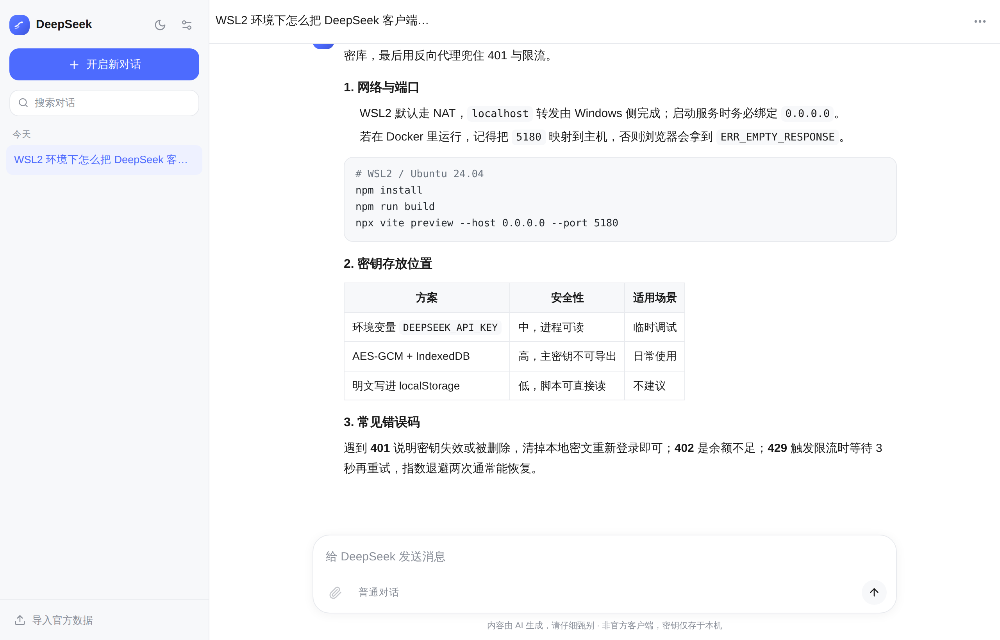

---

## 目录

- [它解决什么问题](#它解决什么问题)
- [界面一览](#界面一览)
- [安卓 APK](#安卓-apk)
- [完整功能清单](#完整功能清单)
- [快速开始](#快速开始)
- [使用指南](#使用指南)
- [官方数据导入与续聊](#官方数据导入与续聊)
- [数据与隐私](#数据与隐私)
- [技术架构](#技术架构)
- [目录结构](#目录结构)
- [开发与测试](#开发与测试)
- [常见问题](#常见问题)
- [已知边界](#已知边界)
- [Roadmap](#roadmap)
- [开源协议与贡献](#开源协议与贡献)

---

## 它解决什么问题

官方 App 用起来顺手，但它的会话数据留在官方账户里：导出来的只是一个 `.zip`，里面是几百 KB 的 JSON，翻不动、搜不了、也接不上后续提问；而想用自己充值的 API 余额，官方并没有提供一个「长得像 App、数据在自己机器上」的客户端。

这个项目把三件事接在一起：

| 你想要的 | 这里的实现 |
| --- | --- |
| 用**自己的 API 余额**，而不是网页额度 | 直连官方 OpenAI 兼容接口，余额在应用内可查，每条回答显示 token 与费用估算 |
| 把**官方导出的历史会话**接着聊下去 | 拖入导出包（或直接粘下载链接）→ 本地解析 → 归一化入库 → 历史消息变成可继续追问的会话，与新消息同库同结构 |
| 界面**就是那个 App 的样子** | 布局、间距、圆角、品牌蓝、气泡、侧栏分组、明暗主题、移动端抽屉逐项对齐；安卓 APK 装到手机后就是一个独立 App |
| 数据**只在自己手里** | 纯前端、无后端，会话存 IndexedDB，凭证 AES-GCM 加密后本地保存，不上传任何服务器 |

一句话：**它是「官方 App 的界面 + 你自己的 API 余额 + 你自己机器上的历史数据」，而且能直接装成安卓 App。**

---

## 界面一览

下面每一张都是在真实构建产物里跑出来的界面截图（由仓库内的 `scripts/screenshots.mjs` 自动抓取，见[开发与测试](#开发与测试)）。

### 1. 登录页

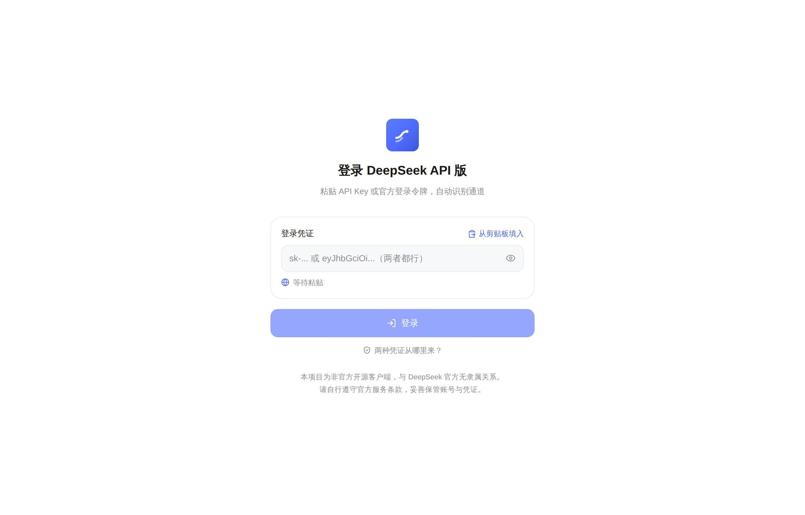

登录页只有**一个输入框**：粘贴什么都能认出来。

- **自动识别**：`sk-` 开头判定为 API Key，走 `GET /user/balance` 校验余额；`eyJ` 开头的长串判定为官方网页令牌，先真实建一次会话确认令牌有效，再写入本地。认不出来会直接说明原因，不会把无效凭证存进库。
- **安卓 App 内登录**：点「在 App 内登录官方账号」，弹出官方登录页（chat.deepseek.com），登录完成后 App 自动把 `userToken` 带回并直接登录，不需要用户去开发者工具里翻 Local Storage。插件只搬运令牌，不接触账号密码。
- **辅助**：支持「从剪贴板填入」并自动提交；自动去掉 `Authorization: Bearer` 前缀和包裹引号；「两种凭证从哪里来？」折叠区常驻说明两条通道的差异与保管方式。

页脚常驻一句免责声明：本项目非官方客户端，凭证只存本机。

### 2. 新建对话 / 欢迎页

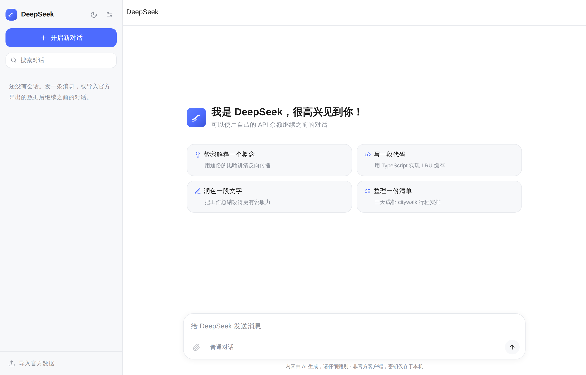

- 侧栏常驻「开启新对话」「搜索对话」，未登录或空库时给出「发一条消息，或导入官方数据」的引导。
- 中间是四个建议胶囊（解释概念、写代码、润色文字、整理清单），点一下即填入输入框。
- 底部是悬浮输入容器：左侧附件按钮（一期占位）、中间多行输入、右侧发送键；空内容时按钮为灰，有内容才变品牌蓝。
- 输入区下方标注当前模式（「普通对话」或「深度思考」）与「内容由 AI 生成」提示。

### 3. 对话页（普通对话）


- 消息区单列，最大阅读宽度约 760px；用户消息靠右、浅灰气泡；助手消息无气泡直接排版，读长文更像文档。
- Markdown 全量渲染：标题、列表、表格、代码块（highlight.js 高亮）、行内与块级公式（KaTeX）。
- 顶部是会话标题（可改）、右侧「更多」菜单；每条助手消息悬浮出现复制、删除。
- 侧栏按「今天 / 近 7 天 / 更早」分组，置顶会话单独一组，导入来的会话带一个「导入」角标。

### 4. 深度思考（R1）

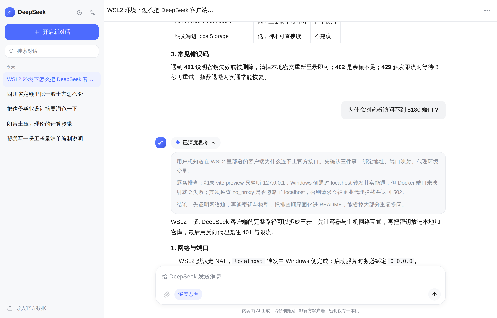

- 选择 `deepseek-reasoner` 后，回答上方出现「已深度思考」折叠区，展开按段落展示推理过程。
- 推理内容走 `delta.reasoning_content` 独立通道累积，与正文分开存储、分开渲染，不会混进最终答案。
- 折叠状态只是组件内部状态，不写数据库，避免污染会话数据。

### 5. 导入官方数据

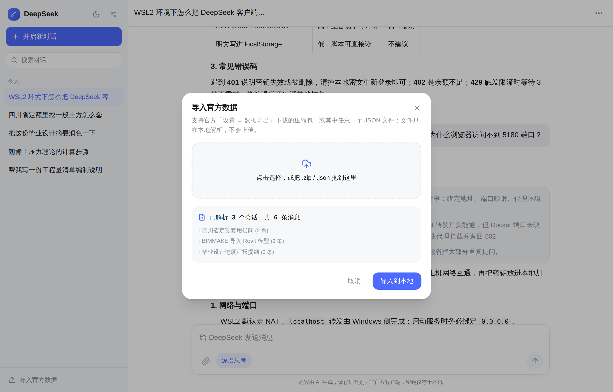

- 弹窗顶部两个页签：「本地文件」支持整包 `.zip` 或其中任意 `.json`，拖拽或点选；「下载链接」直接粘官方导出页的下载地址，App 自己下载并解析。
- 解析后先给预览：会话数、消息数、跳过数，并列出前几个会话及其消息条数，确认后才写库。
- 写入在事务内完成，同 id 会话按「消息并集」合并，重复导入不会产生副本。

### 6. 设置 · 账号

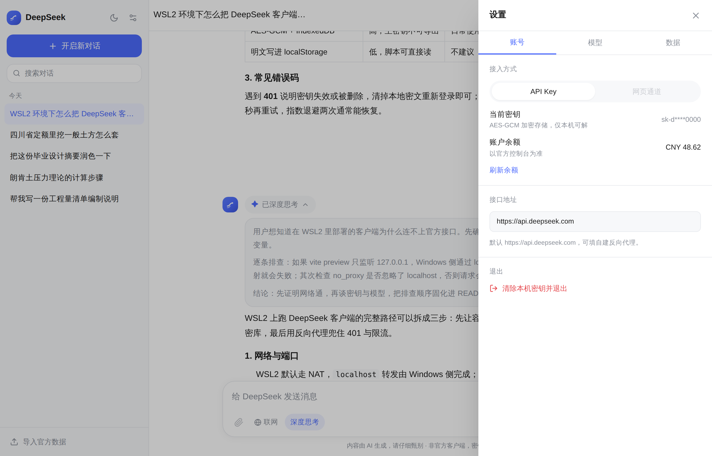

- 两种通道随时切换（未配置的通道置灰），显示密钥掩码与当前余额，可手动刷新。
- 接口地址默认 `https://api.deepseek.com`，可填自建反向代理应对网络拦截。
- 「清除本机密钥并退出」会同时删除密文与内存凭证。

### 7. 设置 · 模型

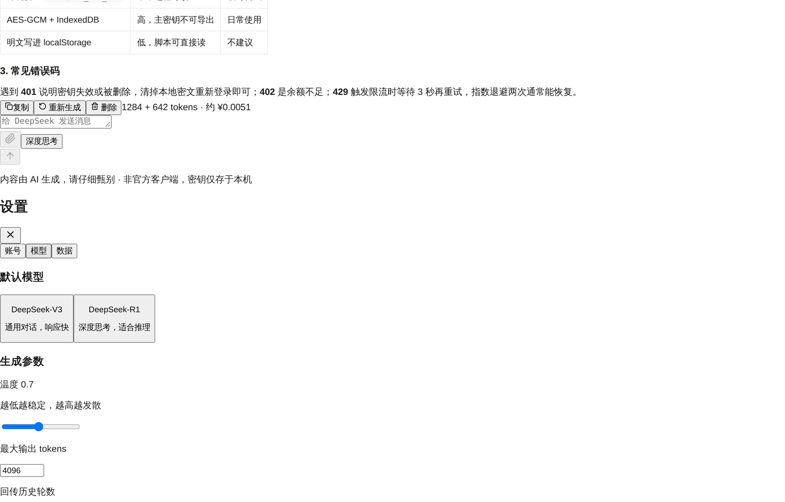

- 模型卡片二选一：DeepSeek-V3（`deepseek-chat`，通用快答）/ DeepSeek-R1（`deepseek-reasoner`，深度推理）。
- 生成参数：温度滑杆（0–1.5）、最大输出 tokens、回传历史轮数（导入会话续聊时的上下文窗口）。
- 系统提示词输入框，长期生效的设定可以写在这里。
- 计费单价按「元 / 百万 tokens」填写，输入输出分开；默认值仅为示例，请以官方最新价格为准。
- 主题（深色 / 浅色）也在这页。

### 8. 设置 · 数据

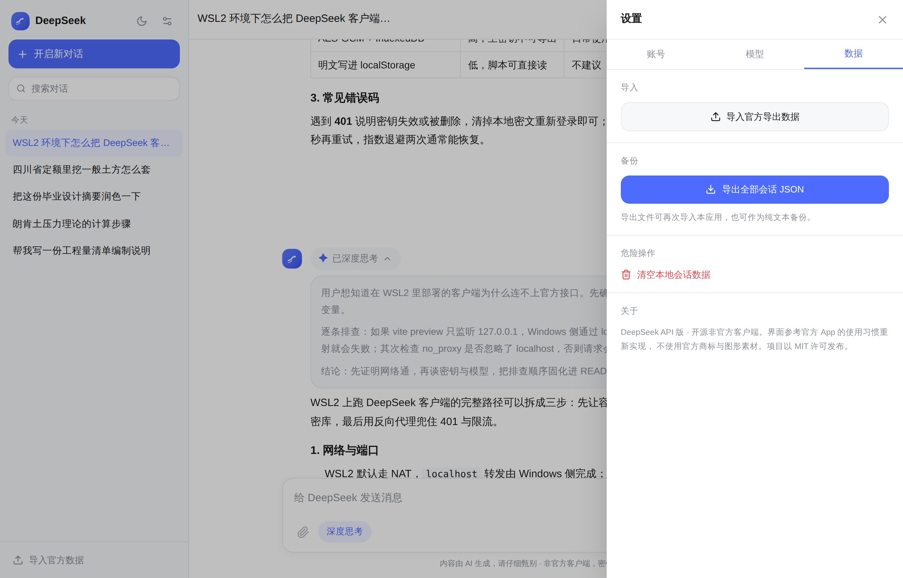

- 「导入官方导出数据」直达导入弹窗。
- 「导出全部会话 JSON」把当前所有会话、消息打成一份可再导入的备份文件。
- 「清空本地会话数据」带二次确认，清空后请用备份恢复。
- 关于区块说明项目定位与许可。

### 9. 深色模式

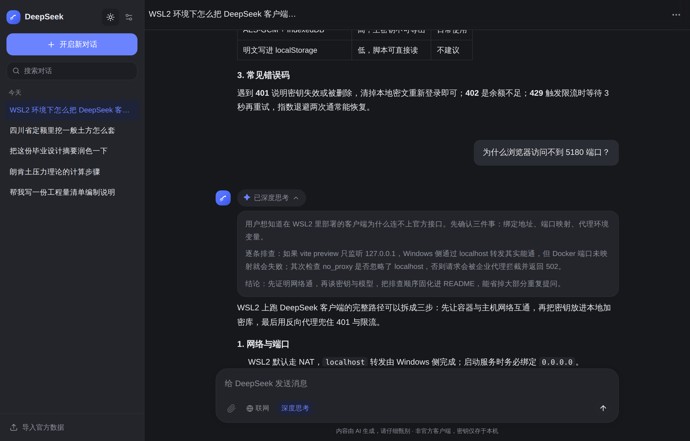

- 主题通过 `data-theme` 切换 CSS 变量，整套配色（页面、卡片、气泡、边框、代码块）一次生效，不是简单反色。
- 侧栏右上角的月亮 / 太阳图标一键切换，选择结果写入设置表，刷新后保持。

### 10. 移动端

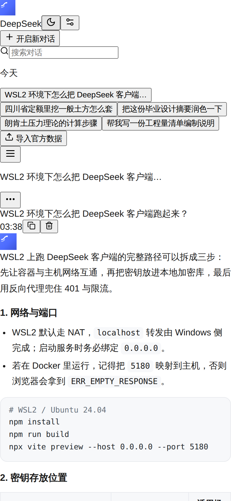

- 宽度小于 768px 时侧栏收起为抽屉，顶部出现汉堡按钮与标题、更多。
- 输入区固定在底部并适配 `env(safe-area-inset-bottom)`，键盘弹起不遮挡。
- 消息、代码块、表格在窄屏下自动换行，长公式可横向滚动。

### 11. 链接一键导入

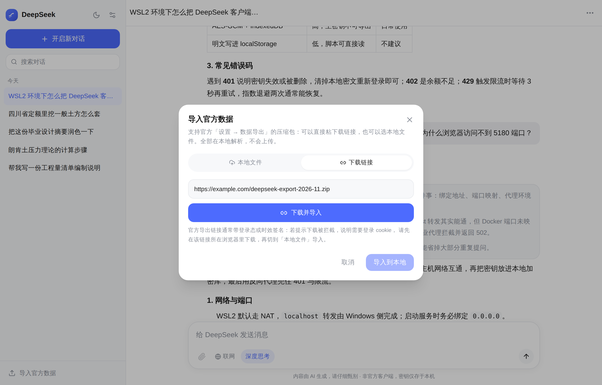

- 粘贴官方「数据导出」给出的下载链接，点「下载并导入」：下载 → 解压 → 解析 → 预览 → 写库，一条链路走完。
- 链接带时效签名或需要登录态时，会分别给出「链接已失效」「需要登录 cookie」的明确提示，并建议改走本地文件，而不是抛一个网络错误。
- 解析与写库完全复用本地导入的同一套代码，行为一致。

---

## 安卓 APK

本项目除了网页版，也以 **Capacitor 封装成安卓 App**，装到手机上就是一个独立图标的应用，不依赖浏览器。

### 直接下载安装

到仓库的 [Releases](https://github.com/lizhengyang-byte/deepseek-api-client/releases) 页下载 `DeepSeek-API-Client-*.apk`，传到手机后点击安装：

1. 系统提示「禁止安装未知来源应用」时，在弹窗里选择允许（设置 → 应用 → 特殊权限 → 安装未知应用）
2. 安装完成后桌面出现「DeepSeek API 版」图标
3. 首次启动后粘贴 API Key，或点「在 App 内登录官方账号」完成登录

> APK 由 GitHub Actions 自动构建，目前为调试签名，可直接安装但不可上架应用商店。若要正式发布，请用你自己的 keystore 重新签名（见下文）。

### 自己打包

```bash
npm install

# 首次：生成原生工程（android/ 目录不入库，随时可重新生成）
npx cap add android

# 每次改代码后：构建前端、同步进原生工程、注入原生登录插件
npm run build
npx cap sync android
node scripts/android-patch.mjs

# 生成启动图标（可选，需要 Playwright）
npx playwright install chromium
node scripts/android-icons.mjs

# 打包 APK
cd android && ./gradlew assembleDebug
# 产物：android/app/build/outputs/apk/debug/app-debug.apk
```

release 包需要在 `android/app/build.gradle` 里配置自己的 keystore，然后：

```bash
cd android && ./gradlew assembleRelease
```

### 与网页版的差异

- 界面、功能、数据模型完全一致，同一套代码，只是换了宿主：安卓 WebView 替代浏览器
- 会话与密钥存在 App 自己的沙箱里（WebView 的 IndexedDB），与浏览器数据互不影响
- 应用内 `fetch` 直连官方接口；WebView 的 origin 是 `https://localhost`，官方接口已回显该 Origin，因此无需额外代理
- 多了一个原生能力：App 内登录插件（`WebLoginPlugin`），内嵌官方登录页并回传令牌；网页版没有这个按钮
- 手势、状态栏、返回键由系统接管：安卓返回键在会话页回到列表，在列表页退出
- 卸载 App 会连同本地会话一起删除，请先用「导出全部会话」做备份

### 环境要求

- 打包机：JDK 17 + Android SDK（platform 34 / build-tools 34）
- 手机：Android 5.1（API 22）及以上，系统 WebView 版本 60+

---

## 完整功能清单

**接入与计费**

- 凭证自动识别：粘贴即分流，API Key 与网页令牌同一个输入框，无效凭证不入库
- App 内官方账号登录（安卓）：内嵌官方登录页，登录后自动取回 userToken 并完成登录
- 剪贴板一键填入、`Authorization: Bearer` 前缀自动清洗
- 余额查询与手动刷新；每条回答记录输入/输出 tokens 与费用估算
- 价格表可配置（默认值为示例），费用一律标注「估算」，真实账单以官方控制台为准

**对话**

- SSE 流式输出，逐字渲染；支持随时「停止生成」并保留已输出内容
- 消息级复制、删除；错误码分级处理（401 回登录、402 提示充值、429 退避、5xx 可重发）
- 历史上下文按「回传轮数」裁剪，控制成本
- 深度思考内容折叠展示

**数据**

- 官方导出包导入：本地文件（拖拽/选择）与**下载链接直连**两种入口，共用同一套解析管线
- 导出格式识别：`mapping` 树 / `messages` / `chat_messages` / `message_list` 四种结构自动识别
- 幂等合并：同一会话 id 重复导入只补消息，不产生副本
- 全部会话导出为 JSON，可再导入
- 会话搜索、重命名、置顶、按时间分组、删除

**界面**

- 明暗主题、品牌蓝设计令牌、圆角输入容器、消息气泡
- 桌面侧栏 / 移动端抽屉、安全区适配、悬停操作菜单
- Markdown + 表格 + 代码高亮 + KaTeX 公式

---

## 快速开始

环境要求：Node.js 18+（推荐 20）。

```bash
git clone https://github.com/lizhengyang-byte/deepseek-api-client.git
cd deepseek-api-client
npm install
npm run dev          # http://localhost:5173
```

> 仓库未提交 `package-lock.json`，因此请用 `npm install`（`npm ci` 会因缺 lock 文件失败）。

打包并部署：

```bash
npm run build        # 类型检查 + 产物输出到 dist/
npm run preview      # 本地预览构建产物
```

`dist/` 是纯静态文件，可直接丢到 GitHub Pages、Vercel、Cloudflare Pages、NAS 或任意 Nginx 目录，不需要后端。

---

## 使用指南

### 登录：一个输入框，自动分流

粘贴即可，不用先选通道：

| 你粘贴的 | 判定 | 校验方式 | 计费 |
| --- | --- | --- | --- |
| `sk-` 开头 | API Key | `GET /user/balance`，失败直接拦下不入库 | 按你的 API 余额 |
| `eyJ` 开头或超长串 | 官方网页令牌 | `POST /api/v0/chat_session/create` 建一次会话验证有效性 | 走网页账号规则，不产生 API 账单 |

拿到凭证的两种方式：

1. **开放平台**：<https://platform.deepseek.com/api_keys> 创建 `sk-xxx`，复制粘贴，最稳。
2. **App 内登录（仅安卓 APK）**：点「在 App 内登录官方账号」→ 在弹出的官方登录页完成登录 → 令牌自动回填并登录。网页版没有内嵌登录能力，改为在浏览器登录 chat.deepseek.com 后，`F12` → Application → Local Storage → 复制 `userToken` 粘贴。

网页令牌通道依赖官方非公开接口，官方改版可能失效，失效时按提示切回 API Key 即可。

### 对话

输入框回车发送，`Shift + Enter` 换行；生成中右侧按钮变为停止，点击立即中断且保留已输出内容。选择 R1 时回答上方出现「已深度思考」，展开可看推理过程。

### 设置

侧栏齿轮打开设置，三个页签：

| 页签 | 内容 |
| --- | --- |
| 账号 | 通道切换、密钥掩码、余额刷新、接口地址、退出 |
| 模型 | 模型选择、温度、最大 tokens、回传轮数、系统提示词、单价、主题 |
| 数据 | 导入、导出全部会话、清空本地数据、关于 |

---

## 官方数据导入与续聊

1. 官方 App / 网页：设置 → 数据导出，拿到压缩包，或直接复制页面给出的**下载链接**
2. 客户端左下角「导入官方数据」：
   - 有链接 → 切到「下载链接」页签，粘贴后点「下载并导入」，App 自行下载解压
   - 已下载文件 → 切到「本地文件」，把 `.zip` 或 `.json` 拖进去
3. 预览确认会话数与消息数后写入本地
4. 在会话列表点开任意一条，直接在输入框继续提问

解析策略：

- **不绑定文件名**，而是遍历 JSON 找「可枚举出会话对象、且会话内含消息集合」的节点，官方改字段名也能命中
- `mapping` 树按叶子回溯还原线性对话；`messages` / `chat_messages` 数组直接映射
- 时间戳兼容秒 / 毫秒 / ISO 字符串；会话 id 缺失时用「标题 + 首条消息时间」做稳定哈希
- 续聊时历史与本机新消息同库同结构，按「回传轮数」参与上下文，超长历史按尾部截断

---

## 数据与隐私

- **纯本地**：会话、消息、用量、设置全部存在浏览器 IndexedDB（库名 `deepseek-api-client`），无后端、无埋点、无上报
- **密钥加密**：主密钥由 WebCrypto 生成（`extractable: false`），存在独立的 IndexedDB 库；密文与随机 IV 分开保存，明文只在发请求前解密到内存变量
- **导出可控**：备份文件由你主动触发，不含密钥与令牌
- **风险自担**：清理站点数据（或卸载 App）会丢库，请定期「导出全部会话」备份；本应用不承担密钥保管责任

---

## 技术架构

分四层，层间只走明确接口，因此替换传输通道不影响界面与存储：

| 层 | 职责 | 实现 |
| --- | --- | --- |
| 视图层 | 页面、消息渲染、输入框、设置、导入 | React 组件 + Tailwind |
| 状态层 | 会话增删改、流式片段合并、选中会话 | Zustand |
| 领域层 | 上下文裁剪、导入归一化、费用计算、导出 | 纯函数模块 |
| 基础设施层 | IndexedDB、官方 API / 网页通道、加解密、原生登录桥 | Dexie / fetch / WebCrypto / Capacitor 插件 |

技术栈：React 18 · TypeScript 5 · Vite 5 · Tailwind CSS 3 · Zustand · Dexie · react-markdown + remark-gfm + remark-math + rehype-katex + rehype-highlight · JSZip · lucide-react · Capacitor 6

流式解析用 `fetch + ReadableStream` 手动切 SSE（EventSource 不支持 POST 与自定义头），`delta.content` 与 `delta.reasoning_content` 双通道累积。

---

## 目录结构

```
src/
  components/   界面：Sidebar、ChatView、Composer、MessageItem、ThinkingBlock、
                Markdown、LoginScreen、SettingsPanel、ImportDialog、Logo
  store/        Zustand：auth（登录/余额）、settings（模型/主题/单价）、chat（会话与流式）
  lib/          传输：deepseek（API）、web（网页通道）、sse（解码）
                存储：db（Dexie）、crypto（AES-GCM）
                领域：importer（导出包归一化）、usage（计费）、export（备份）
                登录：credential（凭证识别）、linkImport（链接下载）、nativeLogin（原生桥）
  types/        共享类型
  styles/       设计令牌、Markdown 排版、滚动条
native/android/ App 内登录原生插件源码（WebLoginPlugin、MainActivity）
tests/          导入解析、SSE 解码、凭证识别与链接校验单测（17 项）
scripts/        界面截图、安卓图标、原生工程插件注入
assets/android/ 启动图标源文件（SVG）
docs/           技术设计文档、项目规划文档、安卓文档、界面截图
public/         图标
```

---

## 开发与测试

```bash
npm run typecheck   # 类型检查
npm run test        # 单元测试：导入解析器 / SSE 解码器 / 凭证识别 / 链接校验，共 17 项
npm run build       # 类型检查 + 生产构建
```

界面截图由脚本自动生成，避免 README 图文与代码脱节：

```bash
npm run build
npx playwright install chromium      # 仅首次
npm run screenshots                  # 输出到 docs/screenshots/
```

脚本用 `page.route` 拦截 `api.deepseek.com`，返回一份固定的余额与 SSE 假数据，然后走真实的登录、发消息、导入（本地文件与下载链接两种入口）、切主题、切移动端流程，因此截到的是**真实渲染结果**，不是设计稿。本机已有 Chromium 时可用 `CHROMIUM_PATH=/usr/bin/chromium npm run screenshots` 跳过下载。

仓库内置三条 GitHub Actions：

- `ci.yml`：每次 push 跑类型检查、单测与构建
- `screenshots.yml`：改了界面或截图脚本时自动重跑截图并提交回仓库
- `android.yml`：构建安卓 APK（含原生登录插件注入）并发布到 Releases（`android-latest`）

---

## 常见问题

**Q：会不会额外收费？**
不会。请求直接打到官方接口，费用由官方按你账户的 API 余额结算；本应用只做用量展示与估算。

**Q：分不清自己手里的串是 API Key 还是网页令牌？**
不用分。直接粘进登录框，应用会按形态自动判断通道并做对应校验；认不出来会提示原因。

**Q：App 内登录会不会拿到我的密码？**
不会。插件只是打开官方登录页，登录动作完全在官方页面里完成，插件只从页面读取 `userToken` 并回传，不采集账号密码，也不提交任何表单。

**Q：为什么不用 `npm ci`？**
仓库未提交 `package-lock.json`，请用 `npm install`。

**Q：导入后能搜索吗？**
能。侧栏搜索框按标题过滤；消息级全文检索在一期未做。

**Q：数据集很大，链接导入会不会卡死？**
链接导入设置了 200MB 上限与小于 1KB 的异常判定；超出上限会提示改用本地文件，避免手机内存被拖垮。

**Q：网页令牌安全吗？**
它等同于你的网页登录态，只保存在本机加密库中；但该通道依赖非公开接口，随时可能失效，建议优先用 API Key。

**Q：能当 App 装吗？**
可以，仓库已提供安卓 APK：到 [Releases](https://github.com/lizhengyang-byte/deepseek-api-client/releases) 下载装上即可，打包细节见 [安卓 APK 说明](docs/android.md)。iOS 需在 macOS 上用 Capacitor 自行打包。

---

## 已知边界

- 一期不含图片/文件问答、语音输入、多端云同步
- 网页通道不保证长期可用，主路径是 API Key；App 内登录依赖官方登录页当前的令牌存放方式
- 链接导入受跨域与登录态限制，被拦截时需改成本地文件
- 费用为估算，真实账单以官方控制台为准
- 浏览器清理站点数据（或卸载 App）会丢失本地会话，请定期导出备份
- 界面按官方观感对齐，但不使用官方商标与图形素材，因此图标为自绘 / 开源图标库

---

## Roadmap

- [ ] 附件与图片问答
- [ ] 消息级全文检索
- [ ] 提示词库与快捷键
- [ ] 可选自建同步服务（端到端加密）
- [ ] 模型适配器插件化

---

## 开源协议与贡献

[MIT](LICENSE)。Issue / PR 请先读 [CONTRIBUTING](CONTRIBUTING.md)；安全相关问题见 [SECURITY](SECURITY.md)。

- [技术设计文档](docs/technical-design.md)
- [项目规划文档](docs/project-plan.md)
- [安卓 APK 安装与打包](docs/android.md)

---

## English

An **unofficial**, open-source client for DeepSeek, shipped both as a web app and as an **Android APK** (Capacitor WebView wrapper):

- Sign in with your own **API key** (billed through the official API) or a web-session token — one input box auto-detects which kind you pasted
- **Sign in inside the app** (Android): the official login page opens in a WebView and the session token is handed back automatically
- **Import** the official data export — either pick the `.zip` / `.json`, or paste the export download link and let the app fetch it — and **continue the conversation** where it stopped
- UI follows the official app's layout, spacing and interaction rhythm, rebuilt with an original icon set
- Everything stays local: IndexedDB for chats, AES-GCM encrypted credentials, zero backend

```bash
npm install && npm run dev
```

See [界面一览](#界面一览) for a screenshot of every screen. MIT licensed. Not affiliated with DeepSeek.
